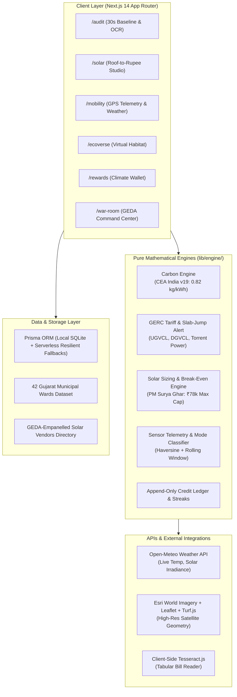

# 🌿 LiFE Gujarat — Mission LiFE Citizen Engagement & Rooftop Solar Platform

[](https://mission-life-gujarat.vercel.app)
[](https://mission-life-gujarat.vercel.app/Mission-LiFE-Gujarat-Project-Report.pdf)
[](https://github.com/utkarsh-johar/mission-life-gujarat)
[](https://github.com/utkarsh-johar/mission-life-gujarat)
[](https://nextjs.org/)
[](https://www.typescriptlang.org/)

> **Problem Statement ID:** `HC26-GEDA01` · **Organisation:** Gujarat Energy Development Agency (GEDA)  
> **Theme:** Track 1: Green Energy & Sustainability · **Category:** Software  
> **Target:** Mobile-First Responsive PWA · **Status:** v1.0 Production-Ready

---

## 🔗 Quick Links

- 🌐 **Production Deployment:** [https://mission-life-gujarat.vercel.app](https://mission-life-gujarat.vercel.app)
- 📄 **10-Slide Pitch Deck & Architecture Report (PDF):** [https://mission-life-gujarat.vercel.app/Mission-LiFE-Gujarat-Project-Report.pdf](https://mission-life-gujarat.vercel.app/Mission-LiFE-Gujarat-Project-Report.pdf)
- 💻 **GitHub Codebase:** [https://github.com/utkarsh-johar/mission-life-gujarat](https://github.com/utkarsh-johar/mission-life-gujarat)
- 🏠 **Local Dev Server:** `http://localhost:3000`

---

## 🎯 Executive Summary & Mission

Prime Minister Narendra Modi launched **Mission LiFE (Lifestyle for Environment)** at Kevadia, Gujarat, to transform environmental protection from policy into mass individual action. 

However, everyday citizens face a disconnect between macro-level climate goals and micro-level daily habits. **LiFE Gujarat** bridges this gap:
1. **Measures** an individual's carbon footprint in under 30 seconds via bill OCR.
2. **Empowers** citizens to calculate exact rooftop solar potential and PM Surya Ghar subsidies directly on satellite imagery.
3. **Incentivises** green commutes (BRTS, Metro, cycling, walking) with real-time GPS telemetry and microclimate weather challenges.
4. **Equips** GEDA state administrators with a live command war-room ranking 42 municipal wards across Ahmedabad, Gandhinagar, Surat, and Vadodara.

---

## 🏛️ System Architecture



---

## 🚀 Key Modules & Feature Highlights

### ⚡ Module A: 30-Second Carbon Audit & Tariff Slab Alert (`/audit`)
- **Frictionless Onboarding:** Baseline carbon footprint calculated in $\le 30$ seconds (or $\le 10$ seconds using one-click demo bills).
- **Client-Side DISCOM Bill OCR:** Tesseract engine extracts consumption units directly from electricity bills (UGVCL, DGVCL, MGVCL, PGVCL, Torrent Power) with **zero storage of private consumer numbers**.
- **GERC Slab-Jump Alert Engine:** Dynamically analyzes your current consumption trajectory against GERC billing tiers (e.g. 100, 200, 250 units) and prescribes the exact daily cut needed to avoid crossing into a higher tariff slab:
  > *"Reduce 1.4 kWh/day for the next 10 days to stay under the 200-unit slab and save ₹142 this month."*
- **Strict Data Provenance:** Every metric can be inspected via an **"ⓘ" icon** showing its pure mathematical formula and regulatory source (CEA India v19 benchmark).

---

### ☀️ Module B: "Roof-to-Rupee" Solar Polygon Studio (`/solar`)
- **Interactive Satellite Mapping:** High-resolution Esri World Imagery tiles with Turf.js geospatial calculation. Citizens draw a simple 4-point polygon around their rooftop.
- **PM Surya Ghar Subsidy Engine:** Full official CFA subsidy schedule calculated automatically:
  - First 2 kW: ₹30,000 / kW
  - 3rd kW: ₹18,000 / kW
  - Max Cap: **₹78,000** for systems $\ge$ 3 kW.
- **10-Year Capital Break-Even Curve:** Interactive Recharts chart with a **golden ReferenceDot** highlighting the exact month of capital recovery ($\approx 3.8 \text{ to } 4.2 \text{ years}$).
- **1-Click Vendor Dispatch & Feasibility PDF:** Dispatches formal quote leads to GEDA-empanelled solar contractors in the user's district and generates an instant client-side feasibility PDF.

---

### 🚲 Module C: Live GPS Green Mobility Tracker & Weather Nudges (`/mobility`)
- **Real-Time Sensor Pipeline:** Calculates Haversine distance, speeds, and running $\text{CO}_2$ avoided against a petrol vehicle baseline ($0.192\text{ kg CO}_2/\text{km}$).
- **Instant Animated Speedometer:** Gauge needle sweeps dynamically between walking ($4.5\text{ km/h}$) and BRTS transit ($42\text{ km/h}$).
- **5x Realistic Commute Simulation Mode:** Embedded 48-waypoint Ahmedabad Janmarg corridor route (Vastrapur Lake $\to$ Panjrapole $\to$ Gujarat University $\to$ Sabarmati Riverfront) for desk judging.
- **Mode Classification Engine:** Automatically detects commute mode based on rolling velocity windows:
  - `WALK` ($< 7\text{ km/h}$)
  - `CYCLE` ($7 \text{ to } 18\text{ km/h}$)
  - `PUBLIC_TRANSIT` ($> 18\text{ km/h}$ with urban station stops)
- **Open-Meteo Weather Nudges:** Pulls local microclimate data to trigger contextual citizen challenges:
  - *Night AC-Off Ventilation Challenge* when ambient temperature drops below $26^\circ\text{C}$.
  - *Peak Solar Load-Shift Challenge* when solar irradiance exceeds $750\text{ W/m}^2$.

---

### 🏆 Module D: Climate Wallet & GEDA Command War-Room (`/rewards` & `/war-room`)
- **Citizen Climate Wallet:** Append-only ledger recording LiFE Green Credits, daily habit streaks with freeze protection, and official GEDA certificates.
- **Anti-Cheat Deduplication:** Computes 64-bit perceptual image hashes (`dHash`) with a Hamming distance threshold to reject re-uploaded habit proof photos.
- **GEDA State Command War-Room (`/war-room`):**
  - Live ranking and composite LiFE scores across **42 municipal wards** in Ahmedabad, Gandhinagar, Surat, and Vadodara.
  - Multi-district filtering, 7-day $\text{CO}_2$ avoidance trend line, and DISCOM participation charts.
  - 1-click administrative **CSV Export** for municipal policy reporting.

---

## 📊 Regulatory Constants & Data Sources

| Parameter | Official Benchmark Value | Regulatory Reference |
| :--- | :--- | :--- |
| **Grid Electricity Emission** | $0.82\text{ kg CO}_2 / \text{kWh}$ | Central Electricity Authority (CEA) India CO₂ Baseline Database v19 |
| **LPG Cylinder Emission** | $42.5\text{ kg CO}_2 / 14.2\text{ kg cylinder}$ | Ministry of Petroleum & Natural Gas (MoPNG) / IPCC Guidelines |
| **Piped Natural Gas (PNG)** | $1.88\text{ kg CO}_2 / \text{SCM}$ | Gujarat Gas / Adani Total Gas standard factor |
| **Petrol Car Emission** | $0.192\text{ kg CO}_2 / \text{passenger-km}$ | Bureau of Energy Efficiency (BEE) India |
| **Electric BRTS / Metro** | $0.038\text{ kg CO}_2 / \text{passenger-km}$ | Ahmedabad Janmarg BRTS / GMRC |
| **Solar Subsidy** | ₹30k/kW (1–2 kW), ₹18k/kW (3 kW), ₹78k Cap | PM Surya Ghar: Muft Bijli Yojana (MNRE 2024) |
| **Average Solar Irradiance** | $5.4\text{ kWh/m}^2/\text{day}$ (Gujarat Avg) | National Renewable Energy Laboratory (NREL) / GEDA |

---

## 🛠️ Technology Stack

- **Frontend & App Architecture:** Next.js 14.2 (App Router), React 18, TypeScript (Strict Mode)
- **Styling & Icons:** Tailwind CSS, Lucide React
- **Data Visualizations:** Recharts (ComposedChart, ReferenceDot, ResponsiveContainer)
- **Geospatial & Mapping:** Leaflet, React-Leaflet, Esri World Imagery, Turf.js
- **Computer Vision & OCR:** Tesseract.js (Client-side, zero server storage)
- **Weather Telemetry:** Open-Meteo REST API (Zero API key dependency)
- **Database & State:** Prisma ORM, Embedded SQLite (Local) with Serverless Fallbacks (Vercel)
- **Automated Testing:** Vitest, Vite Node API (49 automated unit tests)

---

## ⚡ Quick Start (Run Locally in 60 Seconds)

### Prerequisites
- Node.js 18.x or 20.x installed
- Git installed

```bash
# 1. Clone repository
git clone https://github.com/utkarsh-johar/mission-life-gujarat.git
cd mission-life-gujarat

# 2. Install dependencies
npm install

# 3. (Optional) Run automated tests
npm test

# 4. Start local development server
npm run dev
```

Open your browser and navigate to:  
👉 **`http://localhost:3000`**

---

## 🧪 Automated Test Suite

Run the full automated test suite containing 49 unit tests across all mathematical engines:

```bash
npm test
```

```text
 ✓ tests/unit/tariff.test.ts (7 tests)
 ✓ tests/unit/credits.test.ts (7 tests)
 ✓ tests/unit/nudges.test.ts (7 tests)
 ✓ tests/unit/solar.test.ts (3 tests)
 ✓ tests/unit/ocr.test.ts (6 tests)
 ✓ tests/unit/mobility.test.ts (6 tests)
 ✓ tests/unit/carbon.test.ts (6 tests)
 ✓ tests/unit/subsidy.test.ts (7 tests)

 Test Files  8 passed (8)
      Tests  49 passed (49)
```

---

## 👥 Hackathon Submission Details

- **Hackathon Track:** Track 1: Green Energy & Sustainability
- **Problem Statement ID:** `HC26-GEDA01`
- **Organisation:** Gujarat Energy Development Agency (GEDA)
- **Evaluation Partner:** NxtWave
- **Live Vercel Application:** [https://mission-life-gujarat.vercel.app](https://mission-life-gujarat.vercel.app)
- **PDF Project Report:** [https://mission-life-gujarat.vercel.app/Mission-LiFE-Gujarat-Project-Report.pdf](https://mission-life-gujarat.vercel.app/Mission-LiFE-Gujarat-Project-Report.pdf)
- **Repository License:** MIT Open Source
